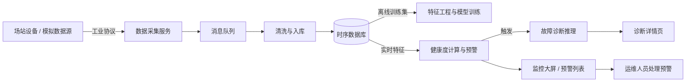
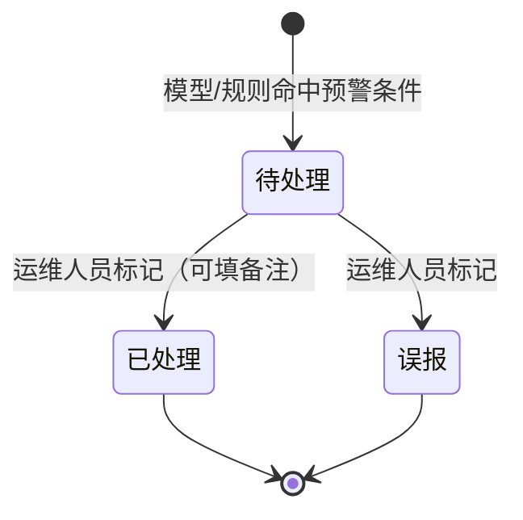

# 新能源设备智能运维与故障诊断系统 · 需求分析

> 版本 v0.1 · 2026-10-18
> 依据项目说明整理。标注 `[TBD]` 的为待确认项，标注 `[假设, TBD]` 的为暂定规则，需团队评审后定稿。

## 1. 背景与目标

### 1.1 背景与问题

新能源场站（光伏、风电、储能）设备类型多、分布分散。传统运维以**定期巡检 + 被动响应**为主，带来两个直接后果：

- **故障发现滞后**——设备异常要等到巡检或故障扩大后才被发现；
- **运维成本高**——分散设备依赖人工巡检，覆盖不足且效率低。

本项目开发一套基于数据驱动的智能运维系统，用持续的设备数据监测、自动预警与智能诊断替代人工巡检节奏。

### 1.2 项目目标（来自项目说明）

1. 构建物联网数据采集与处理模块，接入设备运行数据（电流、电压、温度等）；
2. 构建设备健康度评估模型，实现异常检测与故障预警；
3. 开发故障智能诊断功能，自动分析故障原因并给出维修建议。

### 1.3 产品契约

| 要素 | 定义 |
|---|---|
| 目标用户 | 新能源场站运维人员（日常使用）、系统管理员（配置与权限管理） |
| 核心任务 | 在一个平台上掌握全场设备健康状况，及时发现异常，获得故障原因与维修建议，并闭环处理每条预警 |
| 触发 | 设备持续上报运行数据；系统检测到异常即产生预警 |
| 完成标志 | 运维人员能在系统中完成「看到预警 → 查看诊断详情 → 标记处理结果」的完整闭环 |
| 核心共享对象 | 设备（Device）、预警事件（Alert）、诊断结果（Diagnosis） |

## 2. 范围

### 2.1 P0 最小完整旅程

进入条件：至少一类设备的数据源可对接（真实工业协议或模拟数据源）。

1. 系统按协议采集设备运行数据，完成清洗并入库（M1、M2）；
2. 算法服务基于实时特征计算健康度、产出预警（M4）；
3. 对触发预警的设备自动生成结构化诊断结果（M5）；
4. 运维人员在监控大屏看到告警，在预警列表查看并进入诊断详情页（M6）；
5. 运维人员将预警标记为「已处理」或「误报」，形成处理闭环（M6）。

**完成证据（用户可见）**：预警列表中每条预警都带有诊断入口与处理状态；监控大屏健康度热力图随实时数据刷新。

**最重要的失败恢复路径**：数据采集链路中断（设备断线）→ 自动重连与数据补传，恢复后数据不丢失、不重复（FR-03）。

### 2.2 P1 支持

- 设备拓扑图、历史曲线对比、实时数据流展示（FR-20）；
- WebSocket 实时告警推送（FR-21）——一期可用列表页刷新兜底，P0 旅程仍成立；
- 告警阈值管理界面（FR-22）；
- 用户与权限管理（FR-23）——一期至少区分管理员 / 运维人员两个角色。

### 2.3 明确不在本期范围

- 移动端 App；
- 维修工单流转、备件库存管理；
- 视频监控接入。

以上与核心旅程无关，列出以避免范围蔓延。

## 3. 角色与核心对象

### 3.1 用户角色

| 角色 | 说明 | 主要操作 |
|---|---|---|
| 运维人员 | 场站日常运维值班人员 | 查看大屏 / 预警列表 / 诊断详情，处理预警（标记已处理 / 误报） |
| 系统管理员 | 平台管理方 | 拥有运维人员全部能力，另负责用户管理、告警阈值配置 |

> 注：学生 A / B / C 是**开发分工**而非使用角色，各功能模块标题处标注对应关系。

### 3.2 核心对象

| 对象 | 说明 | 关键属性 | 状态 |
|---|---|---|---|
| 设备 Device | 被监控的场站设备（光伏逆变器、风机、储能变流器等）`[假设, TBD：一期设备类型清单]` | 设备编号、类型、所属场站/区域、测点列表 | 在线 / 离线 `[假设, TBD]` |
| 测点数据 Measurement | 设备上报的单个物理量时序数据（电流、电压、温度等） | 设备 ID、测点编码、数值、时间戳、质量标记 | — |
| 预警事件 Alert | 模型/规则判定设备异常后生成的事件 | 预警 ID、设备、预警等级、预警分数、发生时间、处理状态 | 待处理 / 已处理 / 误报 |
| 诊断结果 Diagnosis | 针对预警事件生成的结构化故障分析 | 关联预警 ID、故障类型、可能原因列表（含置信度）、维修建议 | — |
| 模型版本 ModelVersion | 预警模型的可管理版本 `[假设, TBD]` | 版本号、训练数据范围、评估指标 | 训练中 / 待上线 / 在线 / 已下线 `[假设, TBD]` |

## 4. 系统总体流程

> 分工对应：A = 采集 / 存储 / 接口；B = 算法 / 诊断；C = 可视化 / 集成。

## 5. 功能需求

### M1 设备数据采集与接入（对应分工：学生 A）

**目的**：把设备运行数据持续、完整地接进系统——「接得进」。

**FR-01 工业协议接入**
- 触发：系统启动后，采集服务持续运行。
- 行为：通过 Modbus、OPC UA、IEC 104 中至少一种工业协议，从设备/数据源读取运行数据（电流、电压、温度等测点）。`[TBD：一期实际对接的协议与设备清单]`
- 规则：采集周期可配置；「测点 → 标签」映射可配置，新增设备类型无需修改采集服务代码。
- 结果：原始数据携带设备标识与时间戳进入数据管道（M2）。
- 异常：设备无响应/超时 → 进入 FR-03 断线处理。

**FR-02 模拟数据源** `[假设, TBD：是否作为交付项]`
- 行为：开发与演示阶段提供模拟数据源，按可配置的频率与曲线模式生成多设备测点数据，并支持注入异常模式（如温升过快、电流不平衡）用于验证预警与诊断功能。
- 结果：模拟数据与真实数据走同一条管道，下游无感知。

**FR-03 断线重连与数据补传**
- 触发：设备连接中断或采集服务异常。
- 行为：自动重试重连（重试间隔可配置，采用递增间隔 `[假设]`）；恢复连接后补采中断期间的数据 `[TBD：要求数据源支持历史读取]`。
- 结果：补传数据按时间戳幂等写入（SR-幂等写入），不丢失、不重复。
- 异常：设备长期离线（超过 `[TBD]` 阈值）→ 设备标记为「离线」，在大屏与列表中体现。

### M2 数据存储与质量管理（对应分工：学生 A）

**目的**：数据「存得下、质量高」。

**FR-04 时序数据存储**
- 行为：测点数据存入时序数据库（选型见第 8 节），按设备维度组织标签体系；保留策略可配置（原始数据保留 `[TBD]`，聚合数据保留 `[TBD]`）。
- 结果：支持按设备、时间范围、测点的高效查询，供 M3 接口与模型训练使用。

**FR-05 数据清洗**
- 规则：遵循共享规则 SR-数据质量（去重、插值、噪声滤波）。
- 结果：清洗后数据保留质量标记，算法组可按需获取原始或清洗后数据。

**FR-06 数据质量监控**
- 行为：按设备、测点统计完整率、迟到率、异常值比例。
- 结果：质量指标可查询；低于阈值（`[TBD]`）的设备在监控大屏提示低质量状态。

### M3 数据服务接口（对应分工：学生 A）

**目的**：让算法组和前端「拿得到」数据，是 A 与 B、C 之间的集成契约。

**FR-07 训练数据集接口（离线）**
- 使用方：算法组（M4）。
- 行为：按设备类型、时间范围导出标准化训练数据集（清洗后数据 + 质量标记）。

**FR-08 实时特征数据接口（在线）**
- 使用方：算法服务（M4）。
- 行为：提供设备最新测点值、指定时间窗内时序数据的查询接口；查询延迟满足实时预警需要（NFR-2）。

**FR-09 设备基础信息接口**
- 使用方：前端（M6）。
- 行为：提供设备列表（含类型、区域、在线状态）、设备详情、最新测点值。

### M4 健康度评估与智能预警（对应分工：学生 B）

**目的**：让系统「看得懂、能预判」。

**FR-10 特征工程**
- 行为：基于原始时序数据构建设备健康度特征集，一期至少包含：**温升速率、电流不平衡度、方差突变**（来自项目说明）。
- 规则：每个特征的计算公式与时间窗口 `[TBD]`，由算法组定稿后在此登记为唯一口径。

**FR-11 设备健康度评估**
- 行为：对每台在线设备周期性计算健康度分数（0–100 `[假设, TBD]`），并按 SR-健康度分级映射为等级。
- 结果：健康度分数与等级供监控大屏热力图（FR-17）和设备详情使用；历史趋势可查。

**FR-12 异常检测与故障预警**
- 触发：实时特征流持续输入。
- 行为：
  - 使用 XGBoost 模型进行分类/回归预警（输出故障概率 / 预警分数）；
  - 使用 LSTM 模型进行时序趋势预测，预测值超出阈值即预警 `[TBD：具体预测目标]`。
- 结果：命中预警条件 → 生成预警事件（定义见 3.2），等级按 SR-预警等级。
- 规则：同一设备同一故障类型的重复预警，在 `[TBD]` 时间窗口内合并抑制，避免告警风暴 `[假设]`。

**FR-13 模型管理与在线更新**
- 行为：模型版本化管理（版本号、训练数据范围、评估指标）；新版本评估通过后上线，支持一键回滚到上一版本。
- 结果：模型更新过程不中断预警服务。

**FR-14 模型效果监控**
- 行为：持续跟踪误报率、漏报率 `[TBD：统计口径与基线目标]`；「误报」标记（FR-18）作为统计输入之一。
- 结果：效果报告可查看，作为模型迭代依据。

### M5 故障智能诊断（对应分工：学生 B）

**目的**：让系统「会诊断」——把一条预警变成可执行的维修建议。

**FR-15 诊断推理**
- 触发：预警事件生成后自动触发。
- 行为：结合规则引擎与模型置信度进行故障原因推理（实现形式为决策树或轻量级知识图谱，见第 8 节），输出结构化诊断结果：**故障类型 + 可能原因列表（按置信度排序）+ 维修建议**。
- 结果：诊断结果与预警事件关联存储，供诊断详情页（FR-19）展示。

**FR-16 诊断结果接口**
- 使用方：前端（M6）。
- 行为：按预警事件查询诊断结果，包含故障传播路径数据（供树形图 / 时间线渲染）。

### M6 可视化与运维工作台（对应分工：学生 C）

**目的**：让系统「看得清、用得好、响应快」。

**FR-17 监控大屏**
- 布局：全场设备健康度热力图 + 实时告警滚动条。
- 行为：热力图按健康度等级着色（色阶见 SR-健康度分级），随实时数据刷新（方式见 FR-21 说明）；告警滚动条按时间倒序滚动展示最新预警。
- 异常：设备离线 → 热力图对应区块置灰并标注；某区域无数据 → 显示占位提示而非空白。

**FR-18 预警列表与处理闭环**
- 展示字段：时间、设备、预警等级、预警分数、状态、诊断入口。
- 操作：
  - 标记「已处理」，可填写处理备注 `[假设]`；
  - 标记「误报」——误报记录自动进入模型效果统计（FR-14）。
- 规则：状态流转遵循 SR-预警状态机；已处理 / 误报的预警默认折叠，支持按状态、设备、等级、时间筛选。
- 权限：处理操作限运维人员及以上（SR-权限矩阵）。

**FR-19 诊断详情页**
- 行为：接收后端诊断结果，以**树形图或时间线**展示故障传播路径，并呈现维修建议卡片（故障类型、可能原因、置信度、建议措施）。
- 异常：诊断服务不可用或超时 → 页面明确提示「诊断生成中 / 生成失败」，支持手动重试；预警事件本身仍可查看。

**FR-20 设备拓扑与历史曲线**（P1）
- 设备拓扑图：按场站 / 区域展示设备连接拓扑与健康状态 `[TBD：拓扑数据来源]`。
- 历史曲线：任一测点选定时间范围的历史曲线，支持多测点 / 多设备叠加对比。
- 实时数据流展示：关键测点准实时刷新。

### M7 实时推送与平台管理（对应分工：学生 C）

**FR-21 WebSocket 实时告警推送**（P1）
- 触发：新预警事件产生。
- 行为：向已登录用户推送告警通知（设备、等级、时间、详情入口链接）；大屏与预警列表据此刷新。
- 异常：连接断开自动重连；重连期间由列表页定时刷新兜底。

**FR-22 告警阈值管理**（P1）
- 使用者：系统管理员（SR-权限矩阵）。
- 行为：按设备类型 / 测点配置告警阈值与预警等级映射；修改后对后续预警生效。
- 规则：阈值修改留痕（操作人、时间）`[假设]`。

**FR-23 用户与权限管理**
- 行为：管理员可创建、停用用户账号并分配角色；权限遵循 SR-权限矩阵。
- 登录：账号密码登录 `[假设, TBD：是否需要对接已有账号体系]`。

## 6. 共享规则

**SR-数据质量**（FR-05 引用）：同一设备同一测点同一时间戳视为重复，保留最后到达值 `[假设]`；短时缺失（≤ `[TBD]` 个采集周期）插值补齐，其余缺失不补、打质量标记；噪声滤波方法 `[TBD]`。所有处理保留原始值。

**SR-幂等写入**（FR-03 引用）：实时与补传数据按（设备, 测点, 时间戳）唯一写入，重复到达不产生重复记录。

**SR-健康度分级** `[假设, TBD]`：健康 80–100 / 关注 60–79 / 异常 <60（示例区间，待算法组确认）；热力图色阶对应 绿 / 黄 / 红，离线置灰。

**SR-预警等级** `[假设, TBD]`：三级（低 / 中 / 高），由预警分数按阈值映射；阈值可在阈值管理（FR-22）中配置。

**SR-预警状态机**（FR-18 引用）：

- 已处理、误报为终态，不允许回退 `[假设, TBD：是否允许撤销]`；
- 误报记录进入模型效果统计（FR-14）。

**SR-权限矩阵**：

| 能力 | 运维人员 | 系统管理员 |
|---|---|---|
| 查看大屏 / 预警列表 / 诊断详情 | ✓ | ✓ |
| 标记预警（已处理 / 误报） | ✓ | ✓ |
| 告警阈值配置 | ✗ | ✓ |
| 用户管理 | ✗ | ✓ |

**SR-告警通知**：新预警通过大屏滚动条即时呈现；WebSocket 推送（FR-21）上线后作为第二通知通道。通知内容含设备、等级、时间与详情入口。

## 7. 非功能需求

| 编号 | 类别 | 要求 |
|---|---|---|
| NFR-1 | 可用性 | 采集与预警链路 7×24 运行；单组件故障不导致数据丢失（消息队列缓冲，对应项目说明「高可用」） |
| NFR-2 | 实时性 | 设备数据产生到预警列表可见的端到端延迟 `[TBD：目标值，建议秒级]`；页面操作响应及时（项目要求「响应快」），具体指标 `[TBD]` |
| NFR-3 | 数据规模 | 支持的设备数、测点数与采样频率 `[TBD：按一期接入规模确定]`；存储保留策略见 FR-04 |
| NFR-4 | 可扩展性 | 新增设备类型 / 协议通过配置扩展，不修改核心代码（FR-01 规则） |
| NFR-5 | 模型质量 | 误报率 / 漏报率持续监控（FR-14），基线目标 `[TBD]` |

## 8. 约束与既定技术选型（来自项目说明）

- **语言与框架**：Python 生态；Web 后端 Flask / Django；模型服务 RESTful API（Flask / FastAPI）；前端 Vue3 + Element Plus 或 React + Ant Design（二选一，`[TBD]` 待学生 C 确认）；
- **数据设施**：时序数据库 TDengine 或 InfluxDB（`[TBD]` 二选一）；消息队列 Kafka 或 MQTT（`[TBD]`，`[假设]` 场站侧汇聚倾向 MQTT、平台内部流转倾向 Kafka）；
- **算法**：XGBoost（分类 / 回归预警）、LSTM（时序趋势预测）；
- **交付物**：系统部署手册（学生 C 负责编写）、前端打包优化、联调测试。

## 9. 待确认问题

| 编号 | 问题 | 影响 |
|---|---|---|
| Q1 | 一期对接真实场站设备还是全部使用模拟数据源？ | 决定 FR-01 的验收方式与 FR-02 的定位 |
| Q2 | 时序数据库选型（TDengine vs InfluxDB）与消息队列选型（Kafka vs MQTT） | 影响学生 A 的存储设计与部署方案 |
| Q3 | 前端框架选型（Vue3 vs React） | 影响学生 C 开工 |
| Q4 | 健康度分级、预警等级阈值与 NFR-2 延迟目标的具体数值 | 影响共享规则定稿与大屏 / 列表展示 |
| Q5 | 一期接入的设备类型与测点清单 | 影响特征工程（FR-10）与阈值配置（FR-22） |

## 10. 术语表

| 术语 | 说明 |
|---|---|
| 测点 | 设备上单个可测物理量的采集点位（如 A 相电流、绕组温度） |
| 健康度 | 系统对设备整体运行状态的综合量化评分（0–100） |
| 误报率 / 漏报率 | 预警错误（把正常判为异常）与遗漏（把异常判为正常）的比例 |
| 保留策略 | 时序数据在数据库中的保存时长与降采样规则 |
| 告警风暴 | 短时间内大量重复告警导致信息不可用 |
| Modbus / OPC UA / IEC 104 | 常用工业通信协议，用于从设备读取运行数据 |
